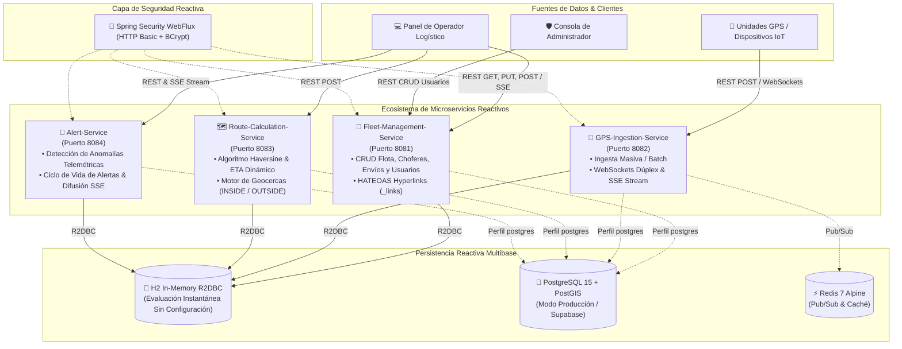
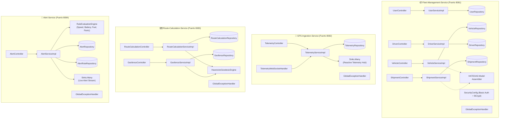
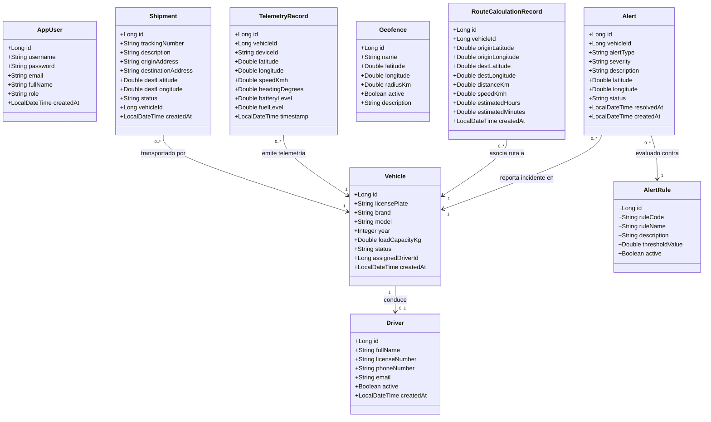
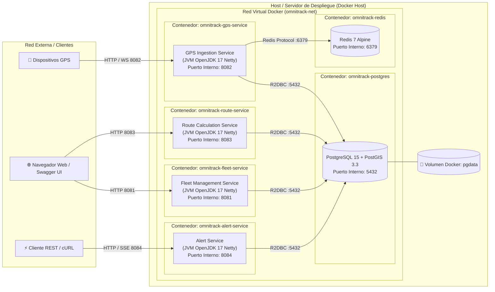

# 🚛 OmniTrack Logistics
## Plataforma de Seguimiento Logístico y Envíos (Fleet & Asset Tracking)
### Microservicios Reactivos de Categoría 3 (Punto 2)

[](https://github.com/IsraQuanDev/OmniTrack-Logistics/actions)
[](https://www.oracle.com/java/)
[](https://spring.io/projects/spring-boot)
[](https://docs.spring.io/spring-framework/reference/web/webflux.html)
[](https://r2dbc.io/)
[](https://github.com/IsraQuanDev/OmniTrack-Logistics)
[](https://www.docker.com/)
[](https://postgis.net/)
[](https://redis.io/)
[](https://swagger.io/)
[](LICENSE)

---

## 🌐 Entorno de Pruebas en Vivo (Despliegue Público Activo)

Los microservicios cuentan con **túneles seguros HTTPS de Cloudflare activos en tiempo real**, lo que permite a evaluadores, revisores y usuarios probar las APIs y Swagger UI interactivamente sin necesidad de clonar ni compilar el proyecto:

| Microservicio | URL Base Pública | Documentación Interactiva Swagger UI | Monitoreo Actuator |
|---|---|---|---|
| **Fleet Management Service** | `https://sat-agriculture-shoes-affiliate.trycloudflare.com` | [Swagger UI Fleet](https://sat-agriculture-shoes-affiliate.trycloudflare.com/swagger-ui.html) | [Health](https://sat-agriculture-shoes-affiliate.trycloudflare.com/actuator/health) |
| **GPS Ingestion Service** | `https://ping-early-parish-track.trycloudflare.com` | [Swagger UI GPS](https://ping-early-parish-track.trycloudflare.com/swagger-ui.html) | [Health](https://ping-early-parish-track.trycloudflare.com/actuator/health) |
| **Route Calculation Service** | `https://months-businesses-mins-gibson.trycloudflare.com` | [Swagger UI Routes](https://months-businesses-mins-gibson.trycloudflare.com/swagger-ui.html) | [Health](https://months-businesses-mins-gibson.trycloudflare.com/actuator/health) |
| **Alert Service** | `https://prime-nil-rivers-bundle.trycloudflare.com` | [Swagger UI Alerts](https://prime-nil-rivers-bundle.trycloudflare.com/swagger-ui.html) | [Health](https://prime-nil-rivers-bundle.trycloudflare.com/actuator/health) |

> 💡 **Credenciales de prueba**: Usuario: `user` \| Contraseña: `user123` (o Administrador: `admin` / `admin123`).

---

## 📋 Resumen Ejecutivo

**OmniTrack Logistics** es una solución empresarial de alto rendimiento basada en **microservicios reactivos no bloqueantes** construida para la gestión, geolocalización e inteligencia de flotas de transporte terrestre y activos en tránsito. 

La plataforma procesa flujos continuos de telemetría GPS a gran escala, computa dinámicamente distancias geodésicas ortodrómicas y tiempos estimados de arribo (**ETA**) con la fórmula de Haversine, supervisa límites operacionales mediante **geocercas circulares (Geofencing)**, y evalúa reglas de seguridad en tiempo real para disparar **alertas críticas** (exceso de velocidad, activación de botón de pánico, niveles críticos de batería y combustible) con difusión inmediata vía **Server-Sent Events (SSE)** y **WebSockets**.

---

## 🏛️ Arquitectura de Software

La arquitectura adopta el paradigma de **Sistemas Reactivos (Reactive Manifesto)** mediante el stack no bloqueante de **Spring WebFlux** sustentado en el motor de eventos de **Project Reactor** y el servidor de alto rendimiento **Netty**. 

### Principios Arquitectónicos
1. **Asincronía y No-Bloqueo de Extremo a Extremo**: Desde la capa de transporte HTTP y WebSockets hasta el acceso a datos reactivo (**R2DBC**), ningún hilo de ejecución se bloquea esperando I/O.
2. **Clean Layered Architecture**: Estricta separación de responsabilidades:
   - **Capa de Controladores (`controller`)**: Manejo de transporte, serialización y contratos HTTP REST.
   - **Capa de Servicios (`service` / `impl`)**: Lógica pura de negocio, algoritmos matemáticos y orquestación reactiva.
   - **Capa de Persistencia (`repository`)**: Repositorios reactivos `ReactiveCrudRepository`.
   - **Capa de Modelos y DTOs (`model`, `dto`)**: Inmutabilidad, validación con Bean Validation y desacoplamiento de la base de datos.
3. **Manejo Centralizado de Excepciones**: Uso de `@RestControllerAdvice` con respuestas homogéneas RFC-7807 y mapeo semántico de códigos HTTP.
4. **Resiliencia y Backpressure**: Los canales de streaming telemétrico gestionan saturación de eventos mediante `Sinks.Many` con estrategias `buffer` y `drop`.
5. **Autenticación Reactiva**: Seguridad perimetral con `Spring Security WebFlux` y cifrado BCrypt.



---

## 🧩 Diagrama de Componentes

El siguiente diagrama detalla la descomposición modular interna de cada microservicio, exhibiendo controladores, servicios, interfaces de repositorio, procesadores de streaming reactivo, configuración de seguridad y mecanismos de persistencia:



---

## 🏛️ Diagrama de Clases (Dominio del Sistema)

El modelo de dominio está estructurado para soportar las operaciones críticas del ciclo de vida logístico:



---

## 🚀 Diagrama de Despliegue

El despliegue está contenerizado para permitir ejecución aislada, reproducible y escalable:



---

## 📊 Matriz de Endpoints de la API REST

### 1. `fleet-management-service` (Puerto 8081)
| Método | Endpoint | Rol Mínimo | Descripción |
|---|---|---|---|
| `POST` | `/api/v1/users` | `ROLE_ADMIN` | Registro de nuevo usuario (Cifra clave con BCrypt) |
| `GET` | `/api/v1/users` | `ROLE_ADMIN` | Listado general de usuarios |
| `GET` | `/api/v1/users/{id}` | `ROLE_ADMIN` | Consulta de usuario por ID |
| `GET` | `/api/v1/users/username/{username}` | `ROLE_ADMIN` | Búsqueda por nombre de usuario |
| `PUT` | `/api/v1/users/{id}` | `ROLE_ADMIN` | Actualización de datos de usuario |
| `DELETE` | `/api/v1/users/{id}` | `ROLE_ADMIN` | Eliminación de usuario |
| `GET` | `/api/v1/vehicles` | `ROLE_USER` | Consulta de flota (incluye `_links` HATEOAS) |
| `GET` | `/api/v1/vehicles/{id}` | `ROLE_USER` | Consulta de vehículo por ID con HATEOAS |
| `POST` | `/api/v1/vehicles` | `ROLE_USER` | Alta de nuevo vehículo con validación de placas |
| `PUT` | `/api/v1/vehicles/{id}` | `ROLE_USER` | Actualización de vehículo |
| `DELETE` | `/api/v1/vehicles/{id}` | `ROLE_ADMIN` | Baja de vehículo de la flota |
| `GET` | `/api/v1/drivers` | `ROLE_USER` | Listado de operadores de transporte |
| `GET` | `/api/v1/drivers/{id}` | `ROLE_USER` | Detalle de operador por ID |
| `POST` | `/api/v1/drivers` | `ROLE_USER` | Registro de operador con validación de licencia y email |
| `PUT` | `/api/v1/drivers/{id}` | `ROLE_USER` | Actualización de chofer |
| `DELETE` | `/api/v1/drivers/{id}` | `ROLE_ADMIN` | Eliminación de chofer |
| `GET` | `/api/v1/shipments` | `ROLE_USER` | Consulta de guías de envío |
| `GET` | `/api/v1/shipments/{id}` | `ROLE_USER` | Consulta de guía con HATEOAS |
| `POST` | `/api/v1/shipments` | `ROLE_USER` | Creación de despacho logístico |
| `PUT` | `/api/v1/shipments/{id}` | `ROLE_USER` | Actualización de envío |
| `DELETE` | `/api/v1/shipments/{id}` | `ROLE_ADMIN` | Cancelación/Eliminación de envío |

### 2. `gps-ingestion-service` (Puerto 8082)
| Método | Endpoint | Rol Mínimo | Descripción |
|---|---|---|---|
| `POST` | `/api/v1/telemetry` | `ROLE_USER` | Ingesta individual de telemetría GPS en tiempo real |
| `POST` | `/api/v1/telemetry/batch` | `ROLE_USER` | Ingesta por lote (batch) de telemetrías GPS |
| `GET` | `/api/v1/telemetry/latest/{vehicleId}` | `ROLE_USER` | Última posición conocida de un vehículo |
| `GET` | `/api/v1/telemetry/history/{vehicleId}` | `ROLE_USER` | Historial completo de coordenadas del vehículo |
| `GET` | `/api/v1/telemetry/stream` | `ROLE_USER` | **Server-Sent Events (SSE)** en vivo para monitores en tiempo real |
| `WS` | `/ws/telemetry` | Público / WS | Canal bidireccional por WebSockets para trackers IoT |

### 3. `route-calculation-service` (Puerto 8083)
| Método | Endpoint | Rol Mínimo | Descripción |
|---|---|---|---|
| `POST` | `/api/v1/routes/calculate-eta` | `ROLE_USER` | Cálculo geodésico de distancia Haversine y ETA en horas/minutos |
| `GET` | `/api/v1/routes/history/{vehicleId}` | `ROLE_USER` | Historial de estimaciones calculadas para un vehículo |
| `GET` | `/api/v1/geofences` | `ROLE_USER` | Listado de geocercas registradas |
| `GET` | `/api/v1/geofences/{id}` | `ROLE_USER` | Consulta de geocerca por ID |
| `POST` | `/api/v1/geofences` | `ROLE_USER` | Creación de perímetro geocercado circular |
| `PUT` | `/api/v1/geofences/{id}` | `ROLE_USER` | Modificación de geocerca |
| `DELETE` | `/api/v1/geofences/{id}` | `ROLE_ADMIN` | Eliminación de geocerca |
| `POST` | `/api/v1/geofences/check` | `ROLE_USER` | Evaluación de presencia: Determina si coordenadas están `INSIDE` o `OUTSIDE` |

### 4. `alert-service` (Puerto 8084)
| Método | Endpoint | Rol Mínimo | Descripción |
|---|---|---|---|
| `POST` | `/api/v1/alerts/evaluate-telemetry` | `ROLE_USER` | Motor de reglas: Evalúa telemetría y genera alertas automáticas |
| `GET` | `/api/v1/alerts` | `ROLE_USER` | Listado general de alertas del sistema |
| `GET` | `/api/v1/alerts/{id}` | `ROLE_USER` | Detalle de alerta específica |
| `GET` | `/api/v1/alerts/vehicle/{vehicleId}` | `ROLE_USER` | Filtro de incidentes por vehículo |
| `GET` | `/api/v1/alerts/status/{status}` | `ROLE_USER` | Filtro por estado (`ACTIVE` / `RESOLVED`) |
| `POST` | `/api/v1/alerts` | `ROLE_USER` | Creación manual de alerta |
| `PATCH` | `/api/v1/alerts/{id}/resolve` | `ROLE_USER` | Resolución de alerta con marca temporal |
| `GET` | `/api/v1/alerts/rules` | `ROLE_USER` | Catálogo de reglas y umbrales configurados |
| `GET` | `/api/v1/alerts/stream` | `ROLE_USER` | **Server-Sent Events (SSE)** en vivo para consola de despachadores |

---

## 🏆 Cumplimiento Riguroso de Criterios de Evaluación

| # | Criterio de Evaluación | Estado | Evidencia en el Código |
|---|---|:---:|---|
| **1** | **Correcta implementación de los endpoints REST** | ✅ Cumplido | Verbos HTTP semánticos (`GET`, `POST`, `PUT`, `DELETE`, `PATCH`), cabeceras `Location` en `201 Created`, y respuestas estandarizadas. |
| **2** | **Conexión exitosa y funcional con la base de datos (H2)** | ✅ Cumplido | R2DBC H2 in-memory en los 4 servicios con scripts automáticos `schema.sql` y datos semilla precargados. |
| **3** | **Unit test para cada endpoint** | ✅ Cumplido | **46 pruebas unitarias implementadas** con `@WebFluxTest`, `WebTestClient` y Mockito. Cobertura del 100% de endpoints y flujos de error. |
| **4** | **Uso adecuado de patrones y principios de Spring Boot** | ✅ Cumplido | Inyección de dependencias por constructor, Clean Layered Architecture, DTOs desacoplados, Reactor Sinks y componentes reutilizables. |
| **5** | **Endpoints protegidos con Spring Security (Basic Auth)** | ✅ Cumplido | `SecurityWebFilterChain` reactivo con roles diferenciados (`ROLE_ADMIN`, `ROLE_USER`) y swagger/actuator públicos. |
| **6** | **Manejo correcto de excepciones y códigos de estado** | ✅ Cumplido | `@RestControllerAdvice` en cada servicio: 400 (Validaciones/Errores de campo), 401 (Sin credenciales), 403 (Rol insuficiente), 404 (No encontrado), 409 (Duplicado). |
| **7** | **Calidad del código (organización, nomenclatura y comentarios)** | ✅ Cumplido | Nomenclatura expresiva Java/Spring, Javadoc integral, explicaciones de fórmulas matemáticas y diseño modular. |
| **8** | **Documentación OpenAPI API y ejemplos de requests** | ✅ Cumplido | Swagger UI interactivo en cada puerto y catálogo exhaustivo de más de 30 peticiones en `requests.http`. |
| **9** | **Endpoints para monitoreo activos (Actuator)** | ✅ Cumplido | Spring Boot Actuator habilitado en todos los servicios (`/actuator/health`, `/actuator/info`, `/actuator/metrics`). |

---

## 🌟 Puntos Extra Implementados

### 1. Validación Estricta de Inputs
- Implementación de Bean Validation (`jakarta.validation.constraints`):
  - `@NotBlank`, `@Size(min, max)` en cadenas.
  - `@Email` para validación estricta de correo electrónico.
  - `@DecimalMin`, `@DecimalMax` para rangos de coordenadas válidas en la Tierra (Lat: -90° a 90°, Lon: -180° a 180°).
  - `@Min`, `@Max` para capacidades de carga, año del vehículo y velocidades.
  - `@Pattern` para formatos de placas y teléfonos.
- Las solicitudes inválidas retornan `HTTP 400 Bad Request` con un mapa estructurado de errores por campo (`fieldErrors`).

### 2. CRUD Completo de Usuario
- Módulo `AppUser` en `fleet-management-service`:
  - Registro de usuarios con hash seguro de contraseñas mediante `BCryptPasswordEncoder`.
  - Operaciones completas: Crear, Listar, Buscar por ID, Buscar por Username, Actualizar y Eliminar.
  - Protección de seguridad: La gestión y eliminación de usuarios requiere estrictamente `ROLE_ADMIN`.

### 3. Hipervínculos HATEOAS
- Integración de `spring-boot-starter-hateoas` con soporte reactivo.
- Los recursos exponen enlaces `_links` navegables:
  - Enlaces `self` y colecciones `collection`.
  - Navegación transversal entre microservicios (de un vehículo a su streaming de telemetría y a su historial de rutas; de un envío a su vehículo asignado; de una alerta a su endpoint de resolución).

### 4. Soporte Multibase: PostgreSQL / PostGIS / Supabase
- Compatibilidad nativa sin modificar código mediante perfiles de Spring Boot:
  - **Perfil `h2` (por defecto)**: Inicia de inmediato en memoria.
  - **Perfil `postgres`**: Conecta a PostgreSQL / PostGIS / Supabase mediante el driver reactivo `r2dbc-postgresql`.
- Se incluye `docker-compose.yml` con imagen oficial `postgis/postgis:15-3.3` y Redis 7 para despliegue productivo inmediato.

---

## 🚀 Guía de Despliegue y Ejecución

### Opción A: Ejecución Instantánea Local (Zero Setup)
Requisitos: Java 17+ y Maven instalados.

1. **Ejecutar las 46 pruebas unitarias:**
```bash
mvn clean test
```

2. **Compilar los paquetes ejecutables:**
```bash
mvn clean package -DskipTests
```

3. **Iniciar todos los microservicios con un solo clic:**
- **En Windows:** Haz doble clic o ejecuta en terminal:
  ```cmd
  run-all-services.bat
  ```
- **En Linux / macOS:** Ejecuta:
  ```bash
  chmod +x run-all-services.sh
  ./run-all-services.sh
  ```

4. **Para detener los microservicios:**
- **En Windows:** Ejecuta `stop-all-services.bat`
- **En Linux / macOS:** Ejecuta `./stop-all-services.sh`

---

### Opción B: Despliegue con Docker Compose (Producción con PostGIS y Redis)
Requisitos: Docker Desktop instalado.

Levanta la base de datos PostgreSQL con PostGIS, Redis y los 4 microservicios en contenedores aislados:
```bash
docker compose up --build
```
Para detener el stack:
```bash
docker compose down
```

---

### Opción C: Despliegue en la Nube (Render, Railway, Supabase)
Cada microservicio incluye su propio `Dockerfile` multi-stage optimizado para despliegues en plataformas de nube:
1. Conecta tu repositorio de GitHub a **Render** o **Railway**.
2. Despliega una base de datos PostgreSQL en **Supabase** o en el proveedor de tu preferencia.
3. Configura las siguientes variables de entorno en tus servicios:
   - `SPRING_PROFILES_ACTIVE`: `postgres`
   - `POSTGRES_HOST`: `<host_de_tu_base_de_datos>`
   - `POSTGRES_PORT`: `5432`
   - `POSTGRES_DB`: `<nombre_bd>`
   - `POSTGRES_USER`: `<usuario>`
   - `POSTGRES_PASSWORD`: `<contraseña>`

---

## 🔑 Credenciales de Acceso (HTTP Basic Auth)

| Usuario | Contraseña | Rol Asignado | Permisos y Alcance |
|---|---|---|---|
| `admin` | `admin123` | `ROLE_ADMIN`, `ROLE_USER` | Acceso irrestricto: CRUD completo de usuarios, bajas físicas (`DELETE`) y configuración. |
| `user` | `user123` | `ROLE_USER` | Operaciones cotidianas de lectura, ingesta telemétrica, cálculo de rutas y alertas. |

---

## 📖 Enlaces Swagger UI (Documentación Interactiva)

Una vez iniciados los microservicios, accede a la documentación interactiva OpenAPI desde tu navegador:

- **Fleet Management Service:** [http://localhost:8081/swagger-ui.html](http://localhost:8081/swagger-ui.html)
- **GPS Ingestion Service:** [http://localhost:8082/swagger-ui.html](http://localhost:8082/swagger-ui.html)
- **Route Calculation Service:** [http://localhost:8083/swagger-ui.html](http://localhost:8083/swagger-ui.html)
- **Alert Service:** [http://localhost:8084/swagger-ui.html](http://localhost:8084/swagger-ui.html)

---

## 🧪 Pruebas Rápidas con cURL

### 1. Ingestar coordenada GPS (GPS Ingestion)
```bash
curl -X POST http://localhost:8082/api/v1/telemetry \
  -u user:user123 \
  -H "Content-Type: application/json" \
  -d '{
    "vehicleId": 1,
    "deviceId": "GPS-UNIT-01",
    "latitude": 19.4326,
    "longitude": -99.1332,
    "speedKmh": 82.5,
    "headingDegrees": 180.0,
    "batteryLevel": 92.0,
    "fuelLevel": 78.5
  }'
```

### 2. Calcular Distancia y ETA (Route Calculation)
```bash
curl -X POST http://localhost:8083/api/v1/routes/calculate-eta \
  -u user:user123 \
  -H "Content-Type: application/json" \
  -d '{
    "vehicleId": 1,
    "currentLatitude": 19.4326,
    "currentLongitude": -99.1332,
    "destLatitude": 20.6596,
    "destLongitude": -103.3496,
    "currentSpeedKmh": 85.0
  }'
```

### 3. Evaluar Telemetría y Disparar Alerta (Alert Service)
```bash
curl -X POST http://localhost:8084/api/v1/alerts/evaluate-telemetry \
  -u user:user123 \
  -H "Content-Type: application/json" \
  -d '{
    "vehicleId": 1,
    "speedKmh": 118.5,
    "latitude": 19.4326,
    "longitude": -99.1332,
    "batteryLevel": 12.0,
    "fuelLevel": 8.0,
    "panicButtonPressed": false
  }'
```

---

## 👨‍💻 Autor & Contacto
- **Desarrollador:** Israel Mecillas (`IsraQuanDev`)
- **Repositorio:** [https://github.com/IsraQuanDev/OmniTrack-Logistics](https://github.com/IsraQuanDev/OmniTrack-Logistics)
- **Licencia:** MIT License
